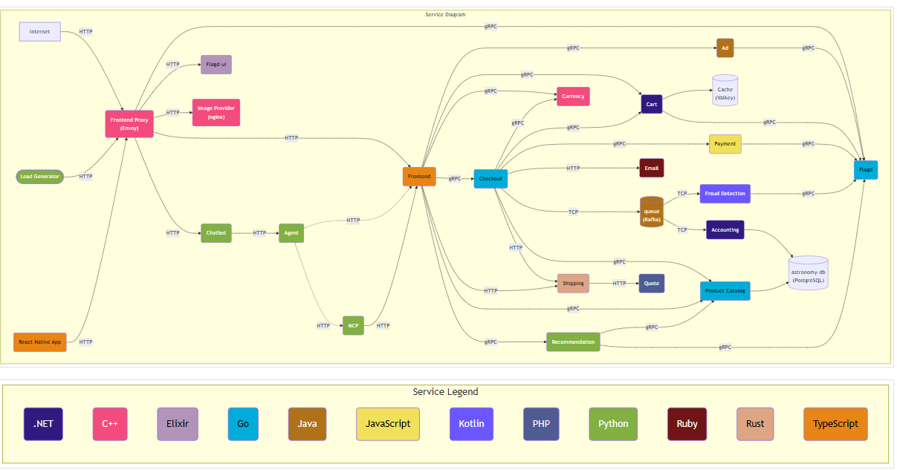
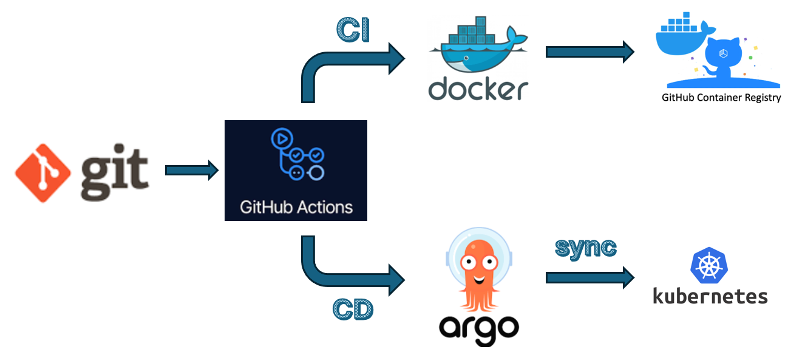

# OpenTelemetry POC

This project demonstrates a practical implementation of containerizing three microservices Go based product catalog service, Java based ad service, Python based recommendation service and deploying them to a Kubernetes cluster using GitOps with GitHub Actions and Argo CD.

# OpenTelemetry Architecture

  

## Purpose

The purpose of this project is to show how multiple microservices can be packaged into containers, deployed to Kubernetes, and managed through an automated GitOps delivery pipeline.

The solution illustrates a modern cloud-native architecture where:
- Three independent microservices are containerized
- Kubernetes manages orchestration, scaling, networking, and service discovery
- GitHub Actions automates the build, validation, and deployment workflow
- Argo CD continuously syncs the cluster with the desired state from Git
- OpenTelemetry provides observability for tracing, metrics, and debugging

## Why this project matters

This project is designed to demonstrate a production-style deployment strategy for distributed applications. It highlights how teams can achieve:
- Repeatable and scalable deployments
- Consistent environments through version-controlled configuration
- Faster release cycles with automation
- Easier rollback and auditability using Git

## GitOps and CI/CD flow

1. Developers update application code or Kubernetes manifests in Git
2. GitHub Actions runs CI checks and builds container images
3. Container images are pushed to a registry
4. Argo CD detects changes in the Git repository and deploys them to the Kubernetes cluster
5. Kubernetes runs the microservices and manages their lifecycle

  

## Technologies used

- Docker / containerization
- Kubernetes / orchestration
- GitHub Actions / automation
- Argo CD / GitOps deployment
- OpenTelemetry / observability
- Git / source control

## Summary

This repository serves as a proof of concept for containerizing microservices and delivering them to a Kubernetes cluster using a GitOps workflow. It showcases the combination of automation, declarative infrastructure, and observability that modern DevOps teams rely on to manage application delivery at scale.
